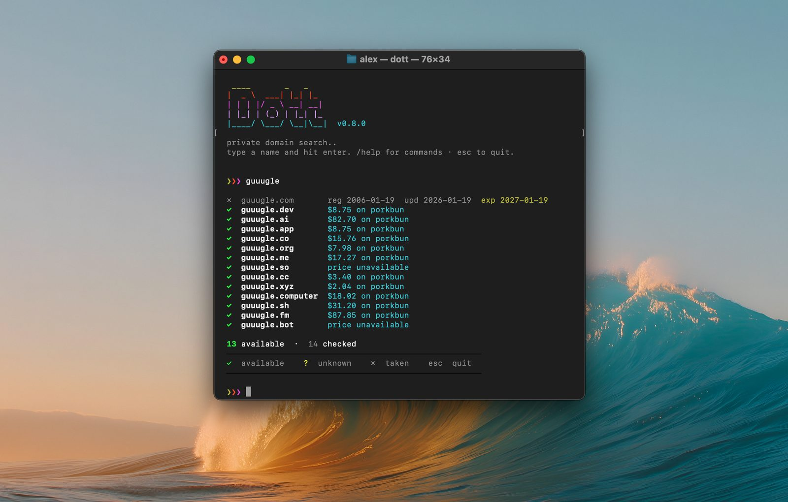

<h1 align="center">dott — domain availability checker for your terminal</h1>

<p align="center">
  <picture>
    <source srcset="preview.avif" type="image/avif">
    
  </picture>
</p>

Domain search for the terminal. Checks RDAP, WHOIS and DNS in parallel, straight against each registry.

## Install

```sh
curl -fsSL https://raw.githubusercontent.com/yodatosh/dott/master/install.sh | sh
```

Works on macOS and Linux (Intel and ARM); on Windows, run it inside WSL. Installs to `~/.local/bin`, or set `DOTT_INSTALL_DIR`.

## Update

`dott --update` (or `/update` in interactive mode) downloads, verifies and swaps in the new binary.

Homebrew was dropped in 0.8.0 to keep things simple: one binary, one installer, one update path. Installed with brew before? Run `brew uninstall dott && brew untap yodatosh/dott`, then the curl line above.

Terminal sessions check GitHub for a new release at most once a day; set `DOTT_NO_UPDATE_CHECK=1` to turn that off.

## Usage

```sh
dott                        # interactive mode
dott myname                 # check your chosen extensions (all by default)
dott myname.io              # check this exact domain
dott myname -t com,io,dev   # check these extensions, this run only
dott -s cool project        # suggest names from keywords
dott myname --plain         # one "<domain> <status>" per line, for scripts
echo myname | dott          # pipe mode (plain)
```

```text
  ✓  myname.com   $11.08 on Porkbun
  ✓  myname.org   $7.98 on Porkbun
  ★  myname.dev   reserved
  ?  myname.gg
  ✗  myname.io    reg 2014-03-02  upd 2025-08-01  exp 2026-08-14

  2 available · 1 taken · 1 reserved · 1 inconclusive
```

`✓` available · `✗` taken · `★` reserved / trademark protected · `?` unknown (inconclusive). Taken names show registered, updated and expiry dates when space allows; expiry turns orange within a year and red within 90 days.

Inconclusive results show a short reason when space allows, such as a registry timeout or rate limit. `/details <domain>` shows the full reason; `/retry` checks only inconclusive names again.

Plain statuses are `available`, `taken`, `protected` and `unknown`; scripts and agents should treat only `available` as available. Invalid input exits nonzero with a message on stderr.

Interactive commands:

Type `/` to see commands immediately, then keep typing to filter. Use ↑/↓ and Enter to choose; commands needing a domain fill in the command and wait for your input. Esc closes the menu.

| Input               | What it does                            |
|---------------------|-----------------------------------------|
| `name` / `name.tld` | check your chosen extensions / one domain |
| `name+`, `+`        | suggest variants (of the last name)     |
| `name+.tld`         | suggest variants on one extension       |
| `/tlds`             | choose extensions (keyboard or mouse)   |
| `/results`         | show the last results again              |
| `/details <domain>` | show details for a result              |
| `/retry`           | retry only inconclusive checks          |
| `/shortlist`       | list saved names                        |
| `/save <domain>`, `/unsave <domain>` | add or remove a shortlisted name |
| `/watch <domain>`   | notify when a domain becomes free       |
| `/unwatch <domain>` | stop watching                           |
| `/list`             | show watchlist                          |
| `/update`, `/help`  | update dott, show commands              |

Your `/tlds` choice is saved in `~/.dott/extensions.json`. `--tlds` overrides it for one run, a full domain always checks just that domain, and plain/piped output ignores it.

Bare-name searches also detect matching supported endings: `phagy` checks `pha.gy`
first, followed by your chosen extensions. These exact spelling matches appear
even when their extension is not selected. Full-domain searches stay exact.

Interactive mode opens on a clean window with the gradient logo and a `❯❯❯` prompt on the bottom row. Typing `/` lists commands above the prompt; Tab completes without running them. Use ↑/↓ for history, ←/→ to edit, Ctrl+W to delete a word, and Ctrl+U to clear. Pasted text stays editable. Live searches show progress; ↑/↓ or Page Up/Down scroll results, and Esc cancels. The extension picker scrolls with keyboard focus. Finished results stay in normal terminal scrollback for selection and copying; `/details <domain>` shows full dates. Shortlists are saved in `~/.dott/shortlist.json`, separately from watches.

Terminal searches flag names that were available at your last conclusive check and are now taken. `~/.dott/checks.json` keeps only the latest known status per domain: up to 2,000 names for 90 days (under 300 KB). Inconclusive checks preserve the previous status. Plain output does not use this history.

## Prices

Available names show standard USD yearly estimates from [Porkbun's public catalog](https://porkbun.com/api/json/v3/pricing/get). Premium names and checkout totals may differ. Prices are refreshed at most once a day and saved in `~/.dott/prices.json`; plain output never includes them.

Results show the first-year estimate, such as `$3.00 on Porkbun`. Use `/details <domain>` for renewal estimates.

Availability appears without waiting for prices. Saved prices show immediately; refreshed prices update available rows while checks continue. Missing estimates get one shared notice.

## Watchlist

```sh
dott --watch myname.com
dott --watching
dott --unwatch myname.com
```

On macOS a LaunchAgent re-checks the list daily at 9am and sends a notification from **dott** when a domain becomes available (dott keeps a tiny helper app at `~/.dott/dott.app` for this; allow it in System Settings → Notifications). Elsewhere, schedule `dott --background-check` yourself.

Changes (became available, was registered, now reserved) also show when you open dott. With zsh, `dott --shell-notice on` adds one marked line to `~/.zshrc` so every new terminal window shows them too; `dott --shell-notice off` removes it, and so does unwatching your last domain. Running `dott --watching` or opening dott marks them as seen.

## How it works

Each domain is checked against the registry's RDAP server, WHOIS (port 43) and Cloudflare DNS-over-HTTPS. Positive registration or protection evidence wins over missing-record replies; missing DNS never means available. Interactive mode pre-opens connections for your chosen extensions (no domain names sent). "Available" means no registration was found — not a guarantee a registrar will sell it.

For `.fyi`, `.live`, and `.computer`, missing registrations also get a registry DPML lookup. Matching trademark-protection records show `★ trademark protected`, never an available price. `/details` explains the record; coverage can have registry and registrar exceptions. These lookups are shared and cached in memory for 60 seconds.

## Supported TLDs

com, net, org, io, dev, app, co, ai, me, so, gg, cc, cv, xyz, live, computer, sh, fm, fyi, work, bot, si, click, fun, gy, ly, to, is, tv, in, id, fr, pt

## License

[MIT](LICENSE)
